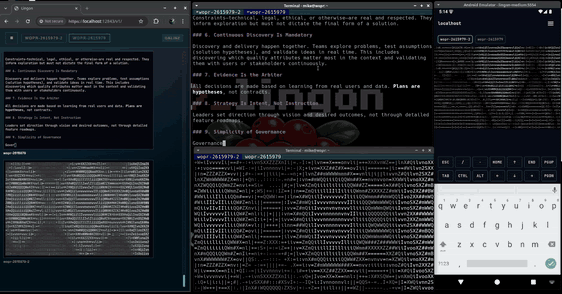
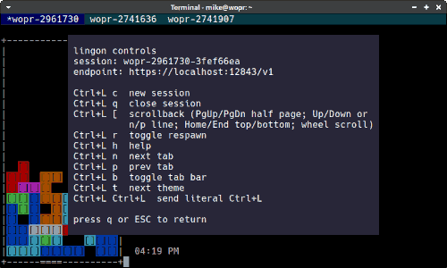

# Lingon


Lingon is a secure, multi-client terminal relay with a CLI, Web UI, and Android app.
It supports these roles and clients:

- **Interactive host (default CLI)**: runs a real terminal session and streams it to the relay.
- **Attach**: connects to a session (TUI or programmatic SDK) to view/control it.
- **Serve**: runs the relay server (HTTPS + WSS + Web UI).
- **Web UI**: browser-based client served by the relay.
- **Android**: native client for Android 8.0 (API 26) and newer.

The host/attach terminal UI paths use a full-framebuffer MVU runtime
(`internal/mvu`) as the canonical renderer and state-transition model.



## Install

Releases provide CLI archives for Linux, FreeBSD and macOS, each on amd64 and
arm64, plus a signed Android APK. Each archive contains a versioned root
directory with `bin/lingon`, a `bin/lingonx` symlink, and
`share/doc/lingon/LICENSE`. Extract the archive and add its `bin` directory to
your `PATH`. See [RELEASE.md](RELEASE.md#artifact-contract) for artifact names
and checksums.

To build the CLI from source, use Go 1.26 or newer and Make:

```bash
make build
./bin/lingon --help
# Optional: install under a user-owned prefix.
mkdir -p "$HOME/.local/bin"
make install PREFIX="$HOME/.local"
```

The install target also creates `lingonx`; add `$HOME/.local/bin` to `PATH` when
using that prefix. Android setup is documented in [android/README.md](android/README.md).

For a system-wide installation:

```bash
make build
sudo make install
```

`make install` copies the existing binary and creates `lingonx`; it does not
build or run verification.

## Quick start

### 1) Bootstrap config + TLS

```bash
lingon bootstrap
```

This creates a default config at `~/.lingon/config.yaml` and a TLS directory at
`~/.lingon/tls`. The Lingon config root defaults to `~/.lingon`; override it
with `-C/--config-dir` or `LINGON_CONFIG_DIR` when you want every default
config/data path rooted somewhere else. Paths inside the config are relative by
default (resolved against the config file location). Use `-c/--config` to write
one specific config file elsewhere, `--set` to override values, `--force` (or
`-f`) to overwrite, and `--regenerate-certificates` to rotate TLS assets.

Examples:

```bash
lingon bootstrap -c /app/config/config.yaml -s server.base=/lingon -s server.tls.dir=/app/certs
lingon bootstrap -f -c /app/config/config.yaml -s server.base=/lingon
lingon bootstrap -c /app/config/config.yaml --regenerate-certificates
lingon bootstrap -s server.tls.hostname=lingon.my.domain.tld -s server.listen=:8443
```

The last example generates a CA and server cert for `lingon.my.domain.tld`
(CN/SAN) and configures the relay to listen on all interfaces at port 8443 when
you run `lingon serve`. Typically you want to
change the listen address to something other than `127.0.0.1:...` to serve over
the network.

### 2) Create a user

```bash
lingon users add alice
```

By default Lingon generates a password and prints it along with the TOTP seed.
Use `--prompt` if you want to enter a custom password.

User administration keeps the same commands and output while the relay is running.
Use the relay's `server.data_dir` and `server.users_file` configuration (or the
matching `--users-file` override). The running relay applies mutations through a
private local socket so its current tokens, revocations and sessions stay intact.
When the relay is offline, the CLI acquires exclusive state ownership before
editing files. If a live owner's local administration is unavailable, the command
reports that error; retry after the relay is ready.

### 3) Start the relay server

```bash
lingon serve
```

By default this listens on `127.0.0.1:12843` with base path `/v1`.

Each data directory has one active relay owner. The private `relay-state.lock`
and `.admin/socket` coordinate the relay and administrative CLI; the ownership
file remains after shutdown, while the kernel lock is released. The state
directory must not be writable by other users, and `.admin` is private. A stopped
owner cannot persist later writes after another owner starts.

### 4) Log in (client side)

```bash
lingon login -e https://localhost:12843/v1
```

Tokens are stored at `~/.lingon/auth.json` by default.
The file stores auth per normalized endpoint key, so switching `-e/--endpoint`
reuses the matching cached refresh/access tokens.

Log out from an endpoint (remote revoke + local token removal):

```bash
lingon logout -e https://localhost:12843/v1
```

### Endpoint selection

When `-e/--endpoint` is omitted, Lingon resolves the endpoint in this order:

1. `--endpoint`
2. explicitly configured `client.endpoint` (config file or `LINGON_CLIENT_ENDPOINT`)
3. single stored endpoint in `~/.lingon/auth.json` when the command is using stored auth
4. built-in default endpoint (`https://localhost:12843/v1`)

Important exceptions:

- `lingon login` never depends on `auth.json`; without `--endpoint` it uses the configured endpoint or the built-in default.
- Explicit `--token` / `--access-token` disables auth-file endpoint inference. Those flows use `--endpoint`, configured `client.endpoint`, or the built-in default.
- Share tokens with an embedded endpoint use that embedded endpoint unless `--endpoint` is explicitly passed. Bare share tokens use `--endpoint`, configured `client.endpoint`, or the built-in default.
- If stored auth contains multiple endpoints, auto-inference fails with an ambiguity error until you pass `--endpoint` or set `client.endpoint`.

### Config root and derived paths

By default Lingon stores config, auth, TLS assets, server data, local headless
state, and logs under `~/.lingon`. It does not use `XDG_CONFIG_HOME` for this
default. Use `-C/--config-dir` or `LINGON_CONFIG_DIR` to move the whole Lingon
root for commands and tests:

```bash
lingon --config-dir /tmp/lingon-dev serve
LINGON_CONFIG_DIR=/tmp/lingon-dev lingon login
```

The explicit `-c/--config` flag still points at a single config file. It does
not, by itself, move other default paths unless those values are relative in
that config file or you also set the config root.

### 5) Start a host session (default CLI)

```bash
lingon -e https://localhost:12843/v1 -s my-session

# Or more commonly: use config and no -s (will generate a session ID)
lingon
```

Lingon uses prefix keystroke `Ctrl+l` as *command introducer*, see `Ctrl+l h` (`ctrl+l` followed by `h`) for help.



### 6) Attach from another terminal

```bash
lingon attach -e https://localhost:12843/v1 my-session
```

With an X11 image in `CLIPBOARD`, press **Ctrl+V** inside an attach terminal or
a remote tab in the host UI to transfer it to the target application. Local
interactive host tabs forward Ctrl+V unchanged: the app already shares the
host's clipboard. Image transfer also works inside tmux and with local
`attach -x`. The originating Lingon process needs access to
`DISPLAY` and its Xauthority cookie; use a key binding that sends the actual
Ctrl+V byte, rather than the terminal emulator's text-paste shortcut.
XQuartz socket-path displays are supported directly on macOS.

PNG is preferred, with JPEG as the fallback. Original encoded bytes are
preserved, up to 32 MiB per image. The entire image is validated before delivery;
decoded images are limited to 33,554,432 pixels and 32,768 pixels per side to
bound decoder allocation. The target clipboard is populated before
Ctrl+V reaches the application. Softline's chat prompt can then read the image
normally and insert its own cached image path. Codex reads PNG from X11, so a
JPEG-only source must be converted to PNG before copying for Codex. When the
source clipboard has no image, Ctrl+V passes through unchanged; bracketed text
paste is unchanged.

Targets with an existing `DISPLAY` use that X11 clipboard. On a headless target,
Lingon gives each session a private, authenticated, loopback X11 clipboard
endpoint and supplies its `DISPLAY`/`XAUTHORITY` to the shell. This endpoint
supports clipboard reads, not graphical X applications. Its socket and cookie
are removed when the session ends. Clipboard access uses native Go, without
CGO, libX11, `xclip`, or a target-side X server.

On an existing X server, Lingon serves up to eight concurrent large-image reads.
A read that makes no progress for 30 seconds is discarded; the selection remains
available to other readers.

Images travel in bounded internal protocol chunks with upload flow control,
the same control authorization as keyboard input, and no terminal replay
storage. The source and target each buffer a bounded image. Android image
upload UI is planned separately; this transfer operation provides its host-side
foundation.

### 7) Open the Web UI

```text
https://localhost:12843/v1/
```

The Web UI is served by the relay at the base path.

## Personas and workflows

### Rendering architecture (CLI TUI)

Lingon CLI host/attach rendering follows a single MVU pipeline:

- **Model**: typed runtime state (`mvu.State`) for tabs, overlays, connectivity, help, wall, scrollback status.
- **Update**: typed actions via `Runtime.ApplyAction(...)`.
- **View**: full-framebuffer composition + delta emission from composed snapshots.
- **Effects**: overlay/tab timers scheduled through `mvu.EffectScheduler`.

This replaced the previous hybrid/non-framebuffer compositor implementation.
`internal/compositor` has been removed; new TUI behavior should integrate
through `internal/mvu`.

### Interactive host (default command)

Run a terminal host that becomes a shared session:

```bash
lingon -e https://relay.example.com/v1 -s prod-shell
```

Interactive host options (selection):

- `-e, --endpoint` relay endpoint (https/wss base URL; assumes `https://` if omitted)
- `-C, --config-dir` Lingon config root directory (default `~/.lingon`; env `LINGON_CONFIG_DIR`)
- `-s, --session` session id
- `--token` access token (overrides stored auth)
- `--auth-file` path to auth file
- `--shell` override login shell path
- `-g, --geometry` terminal size as `COLSxROWS`, for example `80x24`; overrides `--cols`/`--rows`
- `--cols`, `--rows` terminal size (`0` means auto-detect for interactive host; built-in default for headless)
- `--scrollback-lines` scrollback lines
- `--term` TERM value for the PTY
- `-r, --respawn` respawn the shell on exit
- `-o, --offline` start offline; toggle relay publishing with `Ctrl+l o`
- `--hostname-only` show hostname-only connect/disconnect banners
- `--theme` TUI chrome theme (`lingon themes`)
- `--disable-desktop-notifications` disable best-effort local desktop notifications for inactivity walls
- `-k, --insecure` skip TLS verification
- `--log-file` client log file path (empty disables)
- `--trace`, `--trace-file` write a JSONL trace

### Headless local PTY host

Run a detached local PTY host (no local interactive host TUI), accessible through
local unix-socket attach/send/sessions commands:

```bash
lingon -x -s local-shell
```

You can also invoke the same mode by binary name:

```bash
lingonx -s local-shell
```

(`lingonx` includes symlink invocations where `argv[0]` basename is `lingonx`.)

Headless local mode notes:

- `-x, --headless` switches root/attach/send/sessions to local headless mode.
- `-g, --geometry COLSxROWS` sets the headless PTY size; `0` dimensions use built-in defaults because detached headless sessions have no foreground terminal to auto-detect.
- Metadata and sockets are stored under `<config-dir>/headless/`.
- `lingon attach -x` works even when relay publishing is offline/disconnected.
- In `attach -x`, `Ctrl+l o` is local-host control and is allowed.

### Attach

Attach to a session over a TUI client:

```bash
lingon attach -e https://relay.example.com/v1 prod-shell
```

Attach to a share token:

```bash
lingon attach --token "$SHARE_TOKEN"
```

If the share token embeds an endpoint, attach uses it automatically unless you
also pass `--endpoint`. Bare share tokens do not infer from `auth.json`; they
use `--endpoint`, configured `client.endpoint`, or the built-in default.

When switching local headless tabs, a session awaiting its first snapshot keeps
the displayed contents under a loading banner. Its first snapshot replaces the
contents; tab switching does not clear the screen.

#### Create and rename sessions

- In `lingon attach` (including `attach -x`), `Ctrl+l c` starts and selects a
  detached terminal on the selected session's machine, equivalent to `lingon -x`.
- In ordinary interactive `lingon`, `Ctrl+l c` retains its existing behavior:
  create another tab in that host process.
- In either CLI, `Ctrl+l e` opens a rename prompt. Enter saves; Escape cancels.
- Android exposes **New terminal** and **Rename session** in Settings. The Web
  UI exposes them in its session menu.

Remote management requires the session's owner account and a connected host;
it does not require the terminal control lease. Share sessions cannot create or
rename terminals. Local `attach -x` management works while publishing is offline.
New detached terminals inherit the host process's startup directory and terminal
configuration, and survive the creating client or host exiting. Lingon does not
track the running shell's current directory.

Names are display metadata: renaming preserves the session ID, socket filename,
connections, and share tokens. Use the original ID for CLI session arguments.
Names support 1–80 Unicode characters without control characters. Headless names
persist locally and are advertised again on relay reconnect. Interactive names
last for that host process's lifetime. If a request's response is lost, refresh
the session list before trying again; clients do not automatically repeat
uncertain operations. See [session management](SESSION_MANAGEMENT.md).
The Web UI recovers an explicit 401 with one credential refresh and one retry
using the same request ID. Attach bounds credential refresh and the operation
together to 15 seconds; a timeout leaves the terminal available for further input.

Attach options (selection):

- `-e, --endpoint` relay endpoint (https/wss base URL; assumes `https://` if omitted)
- `-C, --config-dir` Lingon config root directory (default `~/.lingon`; env `LINGON_CONFIG_DIR`)
- `-x, --headless` attach via local headless unix socket sessions
- `-t, --token` share token for anonymous attach
- `--access-token` access token for authenticated attach
- `--request-control` request controller lease on connect
- `--pick` interactively pick a session
- `--hostname-only` show hostname-only connect/disconnect banners
- `--theme` TUI chrome theme (`lingon themes`)
- `--disable-desktop-notifications` disable best-effort local desktop notifications for inactivity walls
- `-k, --insecure` skip TLS verification
- `--auth-file` path to auth file
- `--log-file` client log file path (empty disables)
- `--trace`, `--trace-file` write a JSONL trace

### Wall messages and inactivity alerts

Broadcast a wall message to your active sessions:

```bash
lingon wall hello from ops
lingon wall --quiet hello from automation
```

Wall messages are delivered through the relay to connected clients. CLI host and
attach clients show wall messages in the TUI. Local interactive host and attach
clients can also emit best-effort desktop notifications for inactivity walls;
disable that per command with `--disable-desktop-notifications` or in config
with `terminal.disable_desktop_notifications: true`.

`Ctrl+l w` cycles wall inactivity levels for the active session. Configure the
cycle with `--wall-inactive-after` or `terminal.wall_inactive_after`; the
default is `2m,5m,15m`. The relay uses `--wall-timeout` / `server.wall.timeout`
for wall banner display duration.

### Serve

Run the relay server:

```bash
lingon serve
```

Common flags:

- `--listen` listen address (default `127.0.0.1:12843`)
- `--base` base path (default `/v1`)
- `--data-dir` data directory
- `--users-file` user store
- `--connect-limit-count`, `--connect-limit-burst`, `--connect-limit-window`, `--connect-limit-disable` global connection rate limiting
- `--replay-history-bytes` replay history retained for reconnecting clients
- `--tls-mode` `auto|bundle|acme`
- `--tls-dir` local TLS directory (auto mode)
- `--tls-bundle` PEM bundle file (bundle mode)
- `--tls-hostname` hostname for ACME or server cert
- `--tls-cache-dir` ACME cache directory
- `--wall-timeout`, `--wall-inactive-after` wall banner behavior
- `-n, --no-banner` remove login-page branding from served Web UI assets

Reconnect replay is delivered in order by each connection's writer. Large
replays do not consume one live queue slot per frame or hold the session replay
lock during network delivery. Each connection admits at most one queued replay
in addition to the replay being written; a saturated live queue still disconnects
the slow receiver.

Credential changes and user deletion revoke account session-list WebSockets as
well as session participants. Session-list updates also check that the original
account authority remains valid before publishing.

**Reverse proxy note:** WebSocket endpoints (`.../ws/...`) must be proxied to
the relay over HTTP/1.1. If your reverse proxy negotiates HTTP/2 to the
upstream, force HTTP/1.1 for the WebSocket routes (or disable h2 to the relay).

### Web UI

The Web UI is served by the relay server at the base path. Login uses the same
user credentials as the CLI. You can also attach directly from the login form
using a share token (token mode disables username/password/TOTP fields). The
existing URL flow still works via `?token=<share-token>`. Session switching,
sharing, resize control, and themes are all accessible from the menu.

### Android app

The Android app provides a native client with session switching, sharing,
cert management, UI themes, per-session zoom, smooth scrollback panning, and
optional background wall notifications.

Build and run from the root:

```bash
make android-sdk
make android-avd PRESET=medium
make android-emulator PRESET=medium
```

The emulator stays in the foreground. In a second terminal at the repository
root, build and install:

```bash
make android-build
make android-install
```

`make android-install` installs a debug build. To install the release build on
a connected phone, run:

```bash
make android-install-release
```

If more than one device is connected, pass `ADB_SERIAL=<device-serial>` to
`android-install-release`. The target builds the current release before
installing it. Use `APK=/path/to/app-release.apk` to install a specific APK
without rebuilding.

The equivalent targets are available from `android/`:

```bash
cd android
make help
```

The Android `Makefile` includes targets for release builds, AVD setup, and
integration tests.

Android wall behavior:

- Foreground wall messages are shown in-app and do not post Android system notifications.
- Background wall notifications can be enabled from the menu; Android then keeps
  a foreground service active while backgrounded and posts relay wall messages
  as system notifications.
- The app polls for background wall messages only while backgrounded.

## Known caveats and parity notes

- Windows is not a supported Lingon platform. Windows-specific build tags and
  stubs exist only to keep shared packages buildable; they do not establish
  runtime compatibility or support for detached headless mode.
- The CLI no-flicker/tab-overlay invariants are enforced by integration and
  architecture tests in `internal/session`, `internal/attach`, and `internal/mvu`.
- Web UI and Android do not use the `internal/mvu` renderer directly; they use
  the same relay/session protocol but maintain independent UI renderers.
  Minor visual/timing differences across clients can still occur.
- CLI tab switching must preserve the no-flicker invariant, including local and
  remote tabs: no full-screen clear and no separately visible base/tab-overlay
  repaint phases.

## TLS and certificates

Lingon supports three server TLS modes:

- `auto`: generates and stores a local CA and server cert in `tls.dir`.
- `bundle`: loads a PEM bundle (cert + key) from `tls.bundle`.
- `acme`: uses ACME (TLS-ALPN-01) with `tls.hostname` and `tls.cache_dir`.

### ACME mode

When `server.tls.mode` (or `serve --tls-mode`) is set to `acme`, Lingon uses
ACME TLS-ALPN-01 to obtain and renew certificates automatically. This requires:

- `server.tls.hostname` / `--tls-hostname` (public DNS name to request certs for).
- `server.tls.cache_dir` / `--tls-cache-dir` (directory for cert/issuer cache).

The relay must be reachable at the configured hostname over TLS for ACME to
validate the domain (typically on port 443). Certificates are cached under
`tls.cache_dir` and renewed automatically by the ACME manager.

### Export the CA for clients

If you use `auto` mode, export the CA and trust it on clients:

```bash
lingon tls export -o ./lingon-ca.pem
```

Import the CA into your OS/browser trust store for the Web UI. For Android,
import the PEM through the app's certificate-management menu for the relay
endpoint. CLI clients on the bootstrap machine use the CA in their configured
TLS directory; clients on other machines need that CA too, or an OS-trusted
server certificate. The CLI's `--insecure` flag does not apply to the Android app
or browser.

### Insecure mode (not recommended)

You can skip TLS verification with `-k/--insecure` on client commands. This is
useful for quick local testing only.

## Configuration (excerpt)

```yaml
server:
  listen: 127.0.0.1:12843
  base: /v1
  data_dir: .
  users_file: users.json
  tls:
    mode: auto
    dir: tls
    cache_dir: tls/cache
client:
  endpoint: https://localhost:12843/v1
  auth_file: auth.json
terminal:
  term: xterm-256color
  scrollback_lines: 1337
  disable_desktop_notifications: false
  wall_inactive_after: 2m,5m,15m
```

Relative paths are resolved relative to the config file. `~` is not expanded in
config values; use absolute paths or relative paths instead.

## CLI reference (high level)

- `lingon bootstrap` - create config + TLS assets
- `lingon serve` - run relay server
- `lingon login` - authenticate and cache tokens
- `lingon` - start an interactive host session (default command)
- `lingon -x` / `lingonx` - start a detached local headless PTY host session
- `lingon attach` - attach to a session
- `lingon attach -x` - attach to a local headless PTY session
- `lingon send` - send input to a session
- `lingon send -x` - send input to a local headless PTY session
- `lingon wall` - broadcast a wall message to active sessions
- `lingon users` - manage users
- `lingon sessions` - list sessions
- `lingon sessions -x` - list local headless PTY sessions
- `lingon detach <session-id>` - force-stop a local headless PTY session
- `lingon share` - create/revoke share tokens
- `lingon tls` - manage TLS assets
- `lingon completion` - generate shell completion scripts
- `lingon version` - print version/build metadata

Run `lingon <command> --help` for details.

## Makefile

Top-level `Makefile` targets:

- `make build` - build `bin/lingon`
- `make test` - run unit tests
- `make test-webui` - run Web UI integration tests
- `make test-android` - run the Android end-to-end class (other instrumentation classes require explicit selection)
- `make lint` - go vet + golint + golangci-lint
- `make prerelease` - full serial local CI and artifact rehearsal
- `make release VERSION=X.Y.Z RELEASE_MESSAGE='type(scope): change'` - verified squash/tag and clean release build
- `make publish` - publish verified Git/GitHub artifacts, then push the versioned Podman image
- `make push-container` - retry only the final Docker Hub push

See [RELEASE.md](RELEASE.md) for the platform matrix, immutable release contract,
verification gates, artifact layout and Podman Kube development workflow.

Agent-driven checks must run through `bash scripts/verify-contained.sh` or a
target that invokes it. For example, `bash scripts/verify-contained.sh make build`
contains compilation as well as its hygiene check. Run checks serially within
the shared 4 CPU / 4 GiB RAM limit with zero swap. Use `make golangci-lint` for
the repository-pinned linter. `make prerelease` is the full release rehearsal;
focused development checks do not establish release proof.

## SDK

The SDK lives in the `lingon` Go package and mirrors CLI functionality.
See `doc.go` for examples.

> ### Trivia
>
> Lingon is not Klingon. The name comes from the idea that the terminal is a
> place where humans *talk to machines*, using a shared *lingo* the machine
> understands. Lingon makes that lingo usable across *n* platforms and *n*
> simultaneous clients—whether they act as viewers or controllers.
